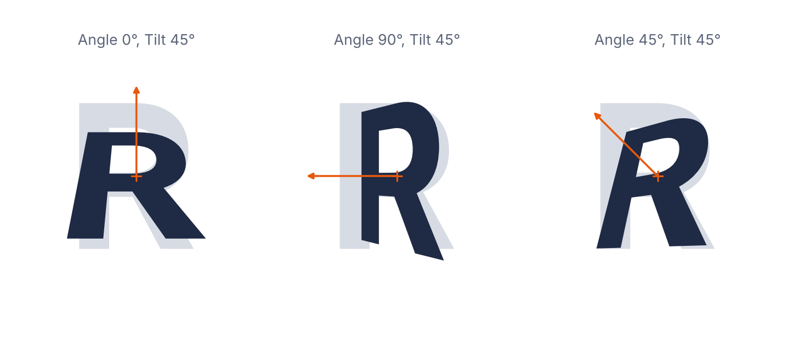

# Tilt

Glyphs.app filter for tilting glyphs in (pseudo) 3D. Parallel edges converge like in a real perspective view, i.e. a rectangle becomes a trapezoid. After installation, trigger the filter with *Filter > 3D Tilt,* enter an angle and a tilt, and apply the values.

- **Angle:** the direction of the tilt in degrees. 0 is north, counterclockwise (90 is west, 180 is south, 270 is east).
- **Tilt of plane:** the tilt of the plane in degrees. The side in the angle direction moves away from the viewer and gets smaller.

Both fields are stepping fields: click into one and use the arrow keys. Instead of a single number, you can enter two numbers with a colon in between, e.g. `10:30`, for a random value between the two. Each glyph gets a new random value, so a range like `-15:15` for the angle makes every glyph tilt in a different direction.

The pivot is always the center of the layer’s bounding box. The filter works on a decomposed copy of the layer (all components, corner components included; without hints; paths cleaned up), and the layer’s shapes are then replaced with the tilted outlines of that copy. The layer’s hints are removed, because they would point to nodes that no longer exist. Anchors are tilted along.



The image above is a rendering of the filter’s algorithm with the *R* of [Inter](https://rsms.me/inter/) (SIL Open Font License), at angles 0°, 90° and 45° and a tilt of 45°. The gray shape is the original, the orange cross the pivot, and the arrow the angle.

### Localization

The menu name, the dialog and the tooltips are localized in German, French, Italian, Portuguese, Spanish, Korean, Czech, Japanese, Simplified Chinese and Traditional Chinese. The menu name, the button and the labels read:

| Language | Menu name | Button | Angle | Tilt |
|---|---|---|---|---|
| English | 3D Tilt | Tilt | Angle (ccw, 0=north) | Tilt of plane |
| Deutsch | 3D-Kippen | Kippen | Winkel (ggUZS, 0=Nord) | Kippung der Ebene |
| Français | Inclinaison 3D | Incliner | Angle (antihoraire, 0=nord) | Inclinaison du plan |
| Italiano | Inclinazione 3D | Inclina | Angolo (antiorario, 0=nord) | Inclinazione del piano |
| Português | Inclinação 3D | Inclinar | Ângulo (anti-horário, 0=norte) | Inclinação do plano |
| Español | Inclinación 3D | Inclinar | Ángulo (antihorario, 0=norte) | Inclinación del plano |
| 한국어 | 3D 기울이기 | 기울이기 | 각도 (반시계, 0=북쪽) | 평면 기울기 |
| Čeština | 3D náklon | Naklonit | Úhel (proti hod. r., 0=sever) | Náklon roviny |
| 日本語 | 3D傾斜 | 傾ける | 角度（反時計回り、0=北） | 平面の傾き |
| 简体中文 | 3D倾斜 | 倾斜 | 角度（逆时针，0=北） | 平面倾斜度 |
| 繁體中文 | 3D傾斜 | 傾斜 | 角度（逆時針，0=北） | 平面傾斜度 |

The tooltips of the two fields, which also explain the `10:30` range, are translated as well. The translations live at the top of `plugin.py` and are easy to correct; pull requests are welcome.

### Custom Parameter

Use the gear menu in the lower left corner of the dialog to copy a custom parameter with the current settings. You can then proceed to paste it in *File > Font Info > Instances,* in the *Custom Parameters* field of a listed font instance. At the end of the parameter value, add `; exclude:` or `; include:`, followed by a comma-separated list of glyph names, for excluding the indicated glyphs at export time, or limiting the filter’s effect to the glyphs, respectively. Example:

```
Tilt; angle:0; tilt:25; exclude: a,b,c,adieresis
```

Add the parameter as a *Filter* custom parameter. If you leave out `angle` or `tilt`, the filter falls back to the value you last set in the dialog, or 0 and 10 degrees, respectively.

In a custom parameter, the colon already separates a name from its value, so write a random range with a tilde instead (the gear menu does that for you). Each glyph gets a new random value:

```
Tilt; angle:-15~15; tilt:20~40;
```

### Installation

**Through the Plugin Manager (recommended):**

1. In *Window > Plugin Manager,* look for *Tilt.*
2. Click the *Install* button next to its entry.
3. Restart Glyphs.

**Manually:** download this repository, double-click `Tilt.glyphsFilter`, let Glyphs install it, and restart Glyphs.

### Requirements

The plugin is built for Glyphs 4. It is a Python plugin; the dialog is made with Vanilla, so there is no Xcode needed to modify it. The code is in `Tilt.glyphsFilter/Contents/Resources/plugin.py`.

### License

Copyright 2026 Rainer Erich Scheichelbauer (@mekkablue).
Based on the filter plug-in template of the Glyphs SDK by Georg Seifert (@schriftgestalt).

Licensed under the Apache License, Version 2.0 (the "License");
you may not use this file except in compliance with the License.
You may obtain a copy of the License at

http://www.apache.org/licenses/LICENSE-2.0

See the License file included in this repository for further details.
